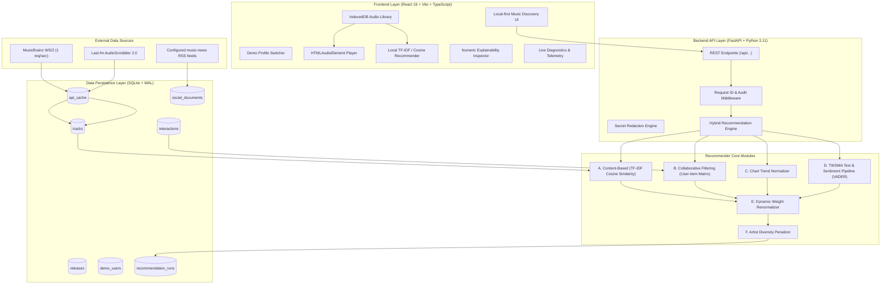

# System Architecture: Social-Aware Hybrid Music Recommender

This document outlines the end-to-end architecture, service boundaries, data pipeline, and mathematical foundations of the Social-Aware Hybrid Music Recommendation System.

---

## 1. High-Level Architecture Diagram

---

## 2. Core Service Modules

### A. MusicBrainz Integration (`backend/app/services/musicbrainz_service.py`)
- Complies strictly with the 1 request/second rule using `MusicBrainzRateLimiter` (token bucket).
- Includes descriptive `User-Agent: TWSMAMusicRecommender/1.0.0 (contact@example.com)`.
- Caches responses in `api_cache` with a SHA-256 parameter hash and 24-hour TTL.
- Zero fake rows are ever inserted if network errors occur.

### B. Last.fm Integration (`backend/app/services/lastfm_service.py`)
- Queries `chart.gettoptracks` when `LASTFM_API_KEY` is provided.
- Trending is reported only when Last.fm returns chart records. MusicBrainz results are not labeled as rankings.

### C. Local Audio Library and Recommendations (Frontend)
- Imported audio bytes stay in browser IndexedDB and are played from local object URLs by an HTML audio element.
- MP3 ID3 title, artist, album, genre, and artwork are read when present; filename parsing and browser duration supplement missing fields.
- Local similarity uses TF-IDF weighted cosine similarity over available title, artist, album, and genre metadata. Online catalogue entries remain metadata only.

### D. TWSMA Text Analytics Pipeline (`backend/app/services/twsma_service.py`)
- Ingests real articles from configured music-news RSS feeds.
- Preprocessing: Strips HTML tags, lowercases text, removes English stopwords, and tokenizes into unigrams.
- Sentiment Extraction: Computes compound polarity valence using `vaderSentiment` in range $[-1.00, +1.00]$.
- Term Frequency: Computes domain vocabulary distributions and matches candidate artists.
- Publication and retrieval timestamps are stored and displayed separately. RSS news mentions are not social-media posts.

### E. Hybrid Recommendation Engine (`backend/app/services/recommendation_engine.py`)
- Computes 4 independent signals:
  1. **Content**: Cosine similarity between target profile genre/tag vectors and candidate tracks.
  2. **Collaborative**: User-item interaction matrix with weighted interactions ($+1.0$ like, $+0.5$ play, $-0.5$ skip, $-1.0$ dislike).
  3. **Trend**: Normalized chart position and listener counts.
  4. **TWSMA Text**: News mention density and sentiment valence.

---

## 3. Dynamic Weight Renormalization Theorem

Let $C = \{\text{content}, \text{collaborative}, \text{trend}, \text{text}\}$ be the set of recommendation components.
Let $w_c \ge 0$ be the configured default weight for component $c$, where $\sum_{c \in C} w_c = 1.00$.

For any evaluated candidate track $t$:
Let $A(t) \subseteq C$ be the subset of components where a valid signal is available.
If $A(t) = \emptyset$, the engine falls back to standard baseline popularity.

Otherwise, the **Effective Weight** $w_{\text{eff}}(c, t)$ for component $c \in A(t)$ is defined as:

$$w_{\text{eff}}(c, t) = \frac{w_c}{\sum_{k \in A(t)} w_k}$$

### Properties:
1. **Normalization**:
   $$\sum_{c \in A(t)} w_{\text{eff}}(c, t) = \frac{\sum_{c \in A(t)} w_c}{\sum_{k \in A(t)} w_k} = 1.00$$
2. **Fairness**: Missing components receive an effective weight of $0$, with zero score imputation.
3. **Boundedness**: If all individual component scores $S_c(t) \in [0.0, 1.0]$, then:
   $$\text{Final Score}(t) = \sum_{c \in A(t)} w_{\text{eff}}(c, t) \times S_c(t) \in [0.0, 1.0]$$

---

## 4. Secret Redaction & Diagnostic Security

The `redact_secrets()` utility recursively scans incoming and outgoing telemetry payloads. Any field matching `{"key", "token", "secret", "password", "authorization", "api_key"}` is strictly masked before writing to structured JSONL logs (`backend/logs/app.log`) or exposing via the `/api/diagnostics/logs` endpoint.
